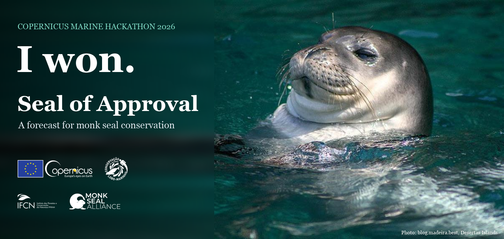
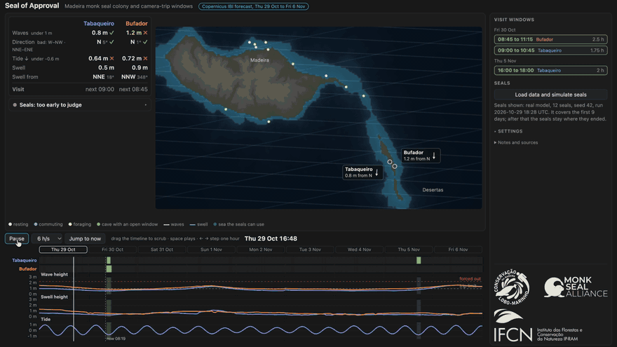

<h1 align="center">🦭 Seal of Approval</h1>

<p align="center">
  <strong>A cave-visit forecast for the Madeira monk seal (<em>Monachus monachus</em>), built on Copernicus Marine data, and the agent-based model behind it</strong>
</p>

<p align="center">
  <a href="https://github.com/alex-kolmakov/seal-of-approval/actions/workflows/lint_typecheck_test.yml">
    
  </a>
  <a href="https://marine.copernicus.eu/">
    
  </a>
</p>

<p align="center">
  
</p>

Fewer than 40 Mediterranean monk seals live around Madeira and depend on two caves on the Desertas. The programme team that looks after them has had to plan cave visits (camera maintenance, colony risk assessment) without a forecast. Seal of Approval turns the Copernicus Marine IBI wave and sea-level forecast into **hourly visit windows for each cave, up to 8 days ahead**, and runs a colony of digital seals on the same forecast to show how it copes with a storm. Built for the Copernicus Marine Hackathon 2026.

## The page

The recording below shows a **calm week first** (green marks mean the cave can be visited; the list on the right gives each window and its length), then a **storm week replayed** (1 to 8 Feb 2026). In the storm week red blocks mean the sea is high enough to force seals out of the cave, and the same forecast drives the digital seals, with the colony table showing how they cope.

<p align="center"></p>

### How to read it

- **Left panel, per cave:** wave height, wave direction (with its bad sector) and tide now, each ticked when it is within the rule, and when the current window ends.
- **Timeline under the map:** one row per cave. Green is a visit window, where all three rules hold. Red is a stretch when waves and tide are high enough to force seals out of the cave (the "forced out" line, about 2.25 m of waves). Below it are the wave height, swell height and tide curves the rules come from.
- **Map:** the two caves with their wave tile's current reading, and the digital seals (white resting, blue commuting, yellow foraging). The bright blue band is the sea the seals can use.
- **Colony condition (storm replay):** energy buffer, energy balance per day, body mass and each seal's state. The header says "Seals do not approve" when the colony's mean energy balance over the last 48 h is 4.5 MJ per seal per day or more below the run's usual level, which is what the Jan-May 2026 storm spells looked like.

A cave is open in an hour when waves are below 1 m, the tide is low, and swell does not come from the cave's bad side. Each cave reads the closest all-sea wave tile, picked with EMODnet bathymetry. The numbers (all editable on the page), their sources and the limits are in [docs/forecast_page.md](docs/forecast_page.md). The thresholds marked "call" come from the programme coordinator and have only one field check behind them.

Stills: [calm week](docs/media/ui-calm-week.png) · [storm replay](docs/media/ui-storm-replay.png).

```bash
git clone https://github.com/alex-kolmakov/seal-of-approval.git && cd seal-of-approval
uv sync
cp .env.example .env     # Copernicus login (free) and the two cave positions, kept out of the repo
uv run python -m src.data_ingestion.download_bathymetry
uv run python prototype/fetch_forecast.py && uv run python prototype/build_forecast.py
uv run python prototype/serve.py   # open http://localhost:8765
```

Needs Python 3.12+, [uv](https://github.com/astral-sh/uv) and, for animations, FFmpeg.

## The model

The page runs on an agent-based model of individual seals: energy balance, stomach load, digestion, body mass, hauling out with the real hourly tide, day trips to feeding grounds, and storm effects. No births yet, so it is not a population model.

```bash
# 30 seals, 1 Jan to 30 May 2026 (data files must exist in data/real_long/)
uv run python -m src.data_ingestion.download_data --from 01-01-2026 --to 30-05-2026
uv run python -m src.simulation.run_real_long --from 01-01-2026 --to 30-05-2026 --agents 30 --seed 42

# colony animation
uv run python -m src.visualization.seal_animator --colony-csv data/real_long/long_sim_results.csv \
  --physics-file data/real_long/physics_20260101_20260530.nc
```

An interactive notebook is also available: `uv run marimo edit notebooks/explore.py`.

## Docs

| Document | Description |
|---|---|
| [Forecast page](docs/forecast_page.md) | Data, visit rules, how to run, limits |
| [Seal agent](docs/seal_agent_documentation.md) | Biology, state machine, sources |
| [Model parameters](docs/model_parameters.md) | Every setting, what it does, how it was calibrated |
| [Data retrieval](docs/copernicus_data_discovery.md) | Copernicus datasets and downloads |
| [Visualization](docs/visualization_guide.md) | Animation tools |

## Development

```bash
uv run pytest
uv run ruff check . && uv run pyrefly check
```

CI runs ruff, pyrefly and pytest on every push.

## Feedback welcome

Many behaviour thresholds are placeholders (tide height at which a cave floods, swell that washes seals off, energy budget). If you work with monk seals and can check them, please [open an issue](https://github.com/alex-kolmakov/seal-of-approval/issues). The settings and their status are in [docs/model_parameters.md](docs/model_parameters.md).

## Credits

Data: [Copernicus Marine Service](https://marine.copernicus.eu/) (IBI forecast), [EMODnet Bathymetry](https://emodnet.ec.europa.eu/en/bathymetry). Field knowledge and thresholds: the IFCN Madeira monk seal programme (VECLAM team). Poster photo: from [blog.madeira.best](https://blog.madeira.best/desertas-islands-madeira) (photographer not named there; reuse rights not confirmed, tell me and I will take it down).

Supports priorities 1 (protecting and restoring ocean health) and 3 (coastal and island communities, outermost regions) of the [European Ocean Pact](https://oceans-and-fisheries.ec.europa.eu/european-ocean-pact_en).
